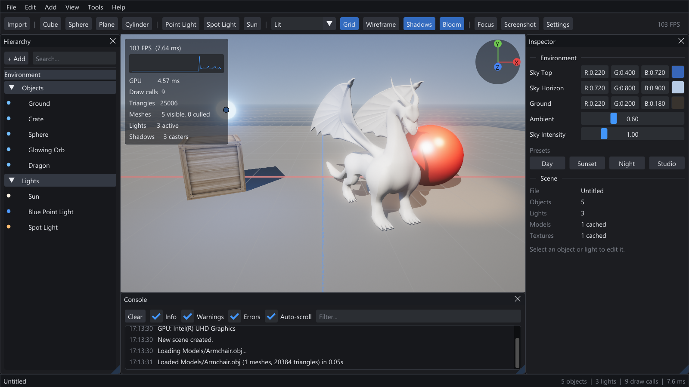

# Absolute Engine

**A small, fast 3D renderer and scene editor written in C++17 and OpenGL 3.3.**

Absolute Engine pairs a compact forward renderer with a complete editor: import models, place lights, tweak materials, and save scenes, all in real time. The code is meant to stay readable and easy to extend, and the engine is light enough to run smoothly on integrated graphics.



---

## Table of Contents

- [Features](#features)
- [Getting Started](#getting-started)
- [Controls](#controls)
- [Using the Editor](#using-the-editor)
- [Settings](#settings)
- [Project Structure](#project-structure)
- [Rendering Pipeline](#rendering-pipeline)
- [Scene File Format](#scene-file-format)
- [Roadmap](#roadmap)
- [Third-Party Libraries](#third-party-libraries)
- [License](#license)

---

## Features

### Rendering
- HDR forward renderer with **Blinn-Phong** shading and energy-normalized specular highlights
- **Directional, point and spot lights**: up to 4 / 32 / 16 at once, uploaded through uniform buffers
- **Shadow mapping** for the sun, with a texel-snapped (shimmer-free) projection, normal-offset bias and adjustable PCF filtering
- **Normal, specular and diffuse maps** with generated tangents, sRGB-correct texturing and anisotropic filtering
- Emissive materials, transparency (sorted back to front) and double-sided materials
- Procedural **sky gradient** with sun disc and hemispheric ambient lighting
- **Post processing**: bloom (13-tap down / tent up-sampling), ACES or Reinhard tone mapping, exposure, gamma, vignette and dithering
- **MSAA** (up to 8x) and **FXAA**
- Debug views: Lit, Albedo, Normals, Lighting Only, plus wireframe

### Performance
- Interleaved vertex buffers and indexed drawing
- Per-mesh **frustum culling** and draw sorting by material to minimize state changes
- Uniform locations are cached and per-frame data goes through two UBO uploads
- **Asynchronous model loading**: OBJ parsing and image decoding run on worker threads, so the editor never freezes
- Shared asset cache: a model or texture used many times is loaded once
- GPU timing through timer queries, plus a CPU frame-time graph
- V-Sync, an FPS limiter, and automatic throttling while the window is minimized or in the background

### Editor
- Resizable **Hierarchy**, **Inspector** and **Console** panels docked to the window edges, plus a menu bar, toolbar and status bar
- **Click to select** with triangle-accurate ray picking
- Fly, orbit and pan camera with smooth focus on the selection
- Transform, material, light and environment editing with live preview
- Environment presets (Day, Sunset, Night, Studio)
- Built-in primitives: cube, sphere, plane and cylinder
- **Drag and drop** `.obj` and `.scene` files onto the window
- Native Windows open/save dialogs, PNG screenshots, shader hot-reload
- Dark, Light and Classic themes with DPI-aware UI scaling
- Settings are saved automatically between sessions

---

## Getting Started

### Requirements
- Windows 10 or 11
- Visual Studio 2022 with the **Desktop development with C++** workload
- A GPU with **OpenGL 3.3** support (any GPU from the last decade, integrated GPUs included)

Every dependency is already in the repository. Nothing else needs to be installed.

### Build and Run
1. Open `Absolute.sln` in Visual Studio 2022.
2. Select **Debug | x64** or **Release | x64**.
3. Press **F5**.

The SDL runtime DLLs are copied next to the executable after each build, and the working directory is set to the project folder so shaders, models and textures load correctly.

### Command Line

```
Absolute.exe [scene.scene] [--capture output.png]
```

| Argument | Description |
|---|---|
| `scene.scene` | Opens a scene on startup |
| `--capture file.png` | Renders the editor, saves the full window as a PNG and exits (handy for documentation and automated checks) |

---

## Controls

| Input | Action |
|---|---|
| Right Mouse + Move | Look around |
| W A S D | Move the camera |
| Q / E | Move down / up |
| Shift | Move faster |
| Right Mouse + Wheel | Change movement speed |
| Alt + Left Mouse | Orbit |
| Middle Mouse | Pan |
| Mouse Wheel | Zoom |
| Left Click | Select an object or light |
| F | Focus the selection |
| Ctrl + D | Duplicate |
| Delete | Delete |
| Esc | Deselect |
| Ctrl + N / O / S | New / Open / Save scene |
| Ctrl + Shift + S | Save scene as |
| Ctrl + I | Import model |
| Ctrl + , | Settings |
| F1 | Controls reference |
| F5 | Reload shaders |
| F11 | Fullscreen |
| F12 | Screenshot |

---

## Using the Editor

**Importing models.** Use *File > Import Model*, the toolbar **Import** button, or drag an `.obj` file onto the window. Materials (`.mtl`) and textures are found next to the model first, then in the `Materials` and `Textures` folders. Very large or very small models are scaled to fit the scene and placed on the ground.

**Adding lights.** Use the toolbar, the *Add* menu, or the **+ Add** button in the Hierarchy. Select a light to change its type, color, intensity, range, cone angles and direction. The selected light shows its range or cone in the viewport.

**Editing materials.** Select an object to edit its diffuse, specular and emissive colors, shininess, opacity and normal strength, and to load or clear its diffuse, specular and normal maps. Hover a texture thumbnail to see a larger preview. Materials of an imported model are shared by every instance of that model.

**Environment.** Click *Environment* in the Hierarchy, or deselect everything, to edit the sky colors, ambient light and sky intensity, or to apply a preset.

**Scenes.** Scenes are saved as readable `.scene` text files that reference models by relative path, so a project folder can be moved or shared as a whole. Screenshots go to the `Screenshots` folder.

---

## Settings

Open **File > Settings** (`Ctrl + ,`). Changes apply immediately and are stored in `settings.ini` when the editor closes.

| Tab | Options |
|---|---|
| Display | Fullscreen, V-Sync, FPS limit, background throttling |
| Rendering | MSAA, FXAA, anisotropic filtering, frustum culling, wireframe, render mode, shadow resolution, filtering and bias |
| Post Processing | Tone mapping, exposure, gamma, vignette, bloom threshold, intensity and radius |
| Camera | Field of view, clip planes, movement speed, mouse sensitivity, invert Y |
| Interface | Theme, UI scale, statistics, axis gizmo, grid, light icons, bounding boxes |

---

## Project Structure

```
Absolute/
├── Source/
│   ├── Core/          Application loop, window, input, settings, logging, math, platform helpers
│   ├── Renderer/      Renderer, shaders, meshes, textures, framebuffers, primitives, debug drawing
│   ├── Scene/         Scene graph, camera, materials, OBJ/MTL loader, asynchronous asset manager
│   ├── Editor/        Dear ImGui based editor UI
│   └── Main.cpp
├── Shaders/           GLSL shaders (Common.glsl is shared through #include)
├── Models/            Sample models
├── Materials/         Sample material libraries
├── Textures/          Sample textures
├── Docs/              Documentation images
└── Libraries/         SDL2, SDL2_image, GLM, Glad, Dear ImGui
```

---

## Rendering Pipeline

Each frame goes through these passes:

1. **Culling.** Visible meshes are frustum-culled and split into opaque (sorted by material) and transparent (sorted back to front) lists.
2. **Shadow pass.** Shadow casters are rendered into a depth map fitted to their bounds, from the first shadow-casting directional light.
3. **Sky.** A full-screen gradient with a sun disc is drawn into the HDR target.
4. **Opaque pass.** Lit shading with every active light, shadows, normal maps and hemispheric ambient light.
5. **Grid and transparent pass.** Blended, without writing depth.
6. **MSAA resolve.** The multisampled target is resolved when MSAA is enabled.
7. **Bloom.** A threshold, a down-sample chain and an additive up-sample chain.
8. **Post processing.** Exposure, tone mapping, vignette, gamma and dithering; optionally followed by FXAA.
9. **Gizmos.** Selection bounds and light shapes, then the editor UI on top.

---

## Scene File Format

Scenes are plain text, so they are easy to read, diff and edit by hand:

```
environment
skyTop 0.22 0.4 0.72
ambient 0.6
end

entity
name Dragon
source Models/Armchair.obj
position 0 0 -0.6
rotation 0 20 0
scale 0.018 0.018 0.018
castShadows 1
end

light
name Sun
type 0
angles -42 35
color 1 0.96 0.9
intensity 2.2
end
```

Built-in primitives use sources such as `primitive:Cube`. Light types are `0` directional, `1` point and `2` spot.

---

## Roadmap

- Translate, rotate and scale gizmos in the viewport
- Undo and redo
- glTF and FBX import
- Physically based materials and image-based lighting
- Point and spot light shadows
- Cascaded shadow maps for large scenes
- Cross-platform builds with CMake (Linux, macOS)
- Physics engine integration

---

## Third-Party Libraries

| Library | Purpose | License |
|---|---|---|
| [SDL2](https://www.libsdl.org/) 2.30 | Window, input, OpenGL context | zlib |
| [SDL2_image](https://github.com/libsdl-org/SDL_image) 2.8 | Image loading and PNG export | zlib |
| [GLM](https://github.com/g-truc/glm) | Mathematics | MIT |
| [Glad](https://github.com/Dav1dde/glad) 2.0 | OpenGL function loader | CC0 / Apache 2.0 |
| [Dear ImGui](https://github.com/ocornut/imgui) 1.91.9 | Editor user interface | MIT |

---

## License

Absolute Engine is released under the [MIT License](LICENSE).
